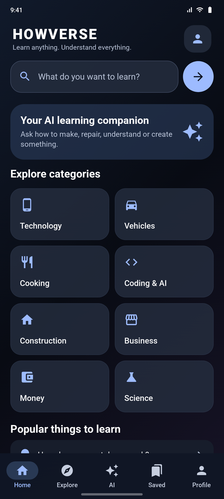
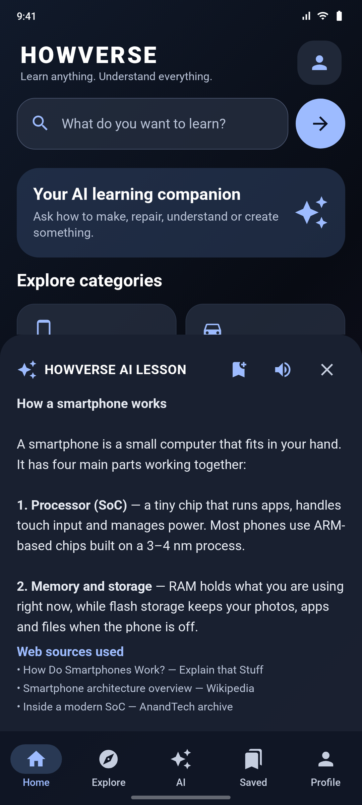
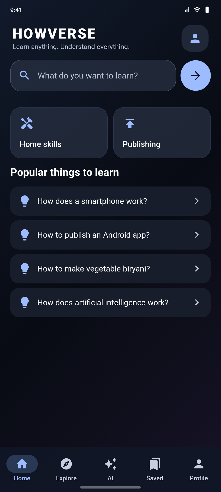
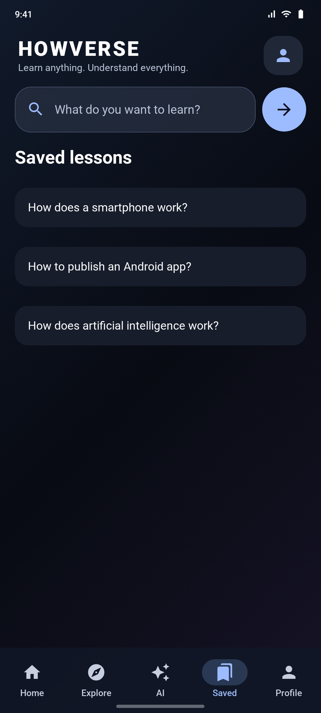

# HOWVERSE


**HOWVERSE** is a Kotlin + Jetpack Compose learning app with a glass-inspired dark UI. Ask any
question — how to make something, repair something, understand something or build something —
and HOWVERSE returns a structured AI lesson, optionally enriched with live web sources, which
you can save and have read aloud.

<p>


</p>

---

## Download the APK

**[⬇ Download HOWVERSE 1.0 (debug APK)](https://github.com/technicalnihilist-lgtm/HOWVERSE/releases/latest)**

Direct file: [`HOWVERSE-1.0-debug.apk`](https://github.com/technicalnihilist-lgtm/HOWVERSE/releases/download/v1.0.0/HOWVERSE-1.0-debug.apk) · 17 MB · Android 8.0 (API 26) and above

This build is signed with the standard Android **debug** key, so it installs with
"Install unknown apps" enabled and is not suitable for Play Store distribution. See
[Building from source](#building-from-source) for a release build.

---

## Screenshots

| Home | AI lesson |
|:---:|:---:|
|  |  |
| Dashboard, search and the ten learning categories | A generated lesson with read-aloud, save and web sources |

| Popular topics | Saved lessons |
|:---:|:---:|
|  |  |
| One-tap starter questions | Lessons saved for the current session |

Full-resolution PNGs (1080 × 2400) are in [`screenshots/`](screenshots).

---

## Features

- **Ask anything** — a single search field in the header turns any question into a lesson.
- **Ten categories** — Technology, Vehicles, Cooking, Coding & AI, Construction, Business,
  Money, Science, Home skills and Publishing, each with a one-tap starter prompt.
- **AI lessons** — the answer arrives in a slide-up lesson panel with a loading state,
  error handling and a close action.
- **Live web sources** — when the backend is configured with a search key, the lesson lists
  the pages its context came from.
- **Read aloud** — Android `TextToSpeech` (en-IN) reads the lesson back to you.
- **Save lessons** — bookmark a lesson and reopen it from the Saved tab during the session.
- **Glass dark UI** — layered gradients, translucent panels and an accent-tinted
  Material 3 colour scheme built entirely in Compose.
- **Responsive Compose layout** — a single `LazyColumn` grid that adapts to any phone size.

---

## How it works

```
┌──────────────────────┐   POST /api/learn    ┌──────────────────────┐   chat completion   ┌────────────┐
│  HOWVERSE Android    │ ───────────────────► │  Express backend     │ ──────────────────► │  AI model  │
│  (Kotlin + Compose)  │ ◄─────────────────── │  (Node.js)           │ ◄────────────────── │  provider  │
└──────────────────────┘  {answer, sources[]} └──────────────────────┘                     └────────────┘
                                                        │ optional
                                                        ▼
                                              ┌──────────────────────┐
                                              │  Web search (Tavily) │
                                              └──────────────────────┘
```

The app never holds a provider key. It calls your own HTTPS backend, and the backend holds
the AI and search credentials.

### Project structure

```
HOWVERSE/
├── app/                                   # Android application module
│   ├── build.gradle.kts
│   └── src/main/
│       ├── AndroidManifest.xml
│       └── java/com/howverse/app/MainActivity.kt   # all UI + networking + TTS
├── backend/                               # Express API that talks to the AI provider
│   ├── server.js
│   ├── package.json
│   └── .env.example
├── screenshots/                           # 1080 × 2400 store-ready screenshots + banner
├── gradle/wrapper/                        # Gradle wrapper (8.11.1)
├── build.gradle.kts · settings.gradle.kts · gradle.properties
├── gradlew · gradlew.bat
└── README.md
```

---

## Building from source

### Requirements

- Android Studio (current stable) or a JDK 17 + Android SDK 35 command line setup
- Android SDK platform 35 and build-tools 35.0.0
- Node.js 18+ for the backend

### 1. Configure the backend

```bash
cd backend
npm install
cp .env.example .env      # then edit .env
npm start                 # http://localhost:3000/health
```

Set `OPENAI_API_KEY` in `.env`. Set `TAVILY_API_KEY` to enable live web search context.
Keep both keys on the server — never in Kotlin, an APK, or this repository.

For a physical phone, deploy the backend to a host with HTTPS and use that HTTPS URL.
For the Android emulator only, use `http://10.0.2.2:3000/` and temporarily allow cleartext
traffic in the manifest. Do not ship an HTTP production endpoint.

### 2. Point the app at your backend

Edit `app/src/main/java/com/howverse/app/MainActivity.kt`:

```kotlin
private const val API_BASE_URL = "https://your-backend.example"
```

The code appends `/api/learn`, so leave the trailing slash off.

### 3. Build

```bash
./gradlew assembleDebug          # app/build/outputs/apk/debug/app-debug.apk
./gradlew assembleRelease        # needs a signing config for distribution
```

Or in Android Studio: **Build → Build Bundle(s) / APK(s) → Build APK(s)**.

The APK attached to the latest release was produced with:

```bash
./gradlew assembleDebug          # versionName 1.0, versionCode 1
```

---

## Tech stack

| Layer | Choice |
|---|---|
| Language | Kotlin 2.0.21 |
| UI | Jetpack Compose (BOM 2024.12.01), Material 3, material-icons-extended |
| Architecture | Single-activity Compose UI, coroutines for IO |
| Networking | OkHttp 4.12 + `org.json` |
| Speech | Android `TextToSpeech` (en-IN) |
| Backend | Node.js 18+, Express 4, express-rate-limit, dotenv |
| Build | AGP 8.7.3, Gradle 8.11.1, JDK 17, compileSdk/targetSdk 35, minSdk 26 |

---

## Status and roadmap

Working today: home dashboard, category browsing, ask HOWVERSE AI, backend AI call, optional
web-search context and source titles, read-aloud, session-scoped saved lessons, responsive
layout.

Planned / still required before a production release:

- Persistent bookmarks with Room or DataStore (saved lessons are currently in memory only)
- Robust Markdown rendering for lesson answers
- Request timeouts, retries and offline states
- Backend authentication, abuse monitoring and stronger server-side safety review
- Crash reporting, privacy policy, and account deletion if accounts are added
- Automated UI and unit tests
- Image generation, only through a separate authenticated backend endpoint

---

## Safety and accuracy

HOWVERSE is a learning aid, not a substitute for licensed professionals. The backend prompt
deliberately limits step-by-step instructions for hazardous repairs, electrical or gas work,
structural work, security bypasses and risky device modifications. Always verify critical
instructions against official manuals and qualified professionals.

---

## Credits

App name, design and source: **HOWVERSE**. Screenshots in this repository were captured at
1080 × 2400 from the app's Compose UI.
