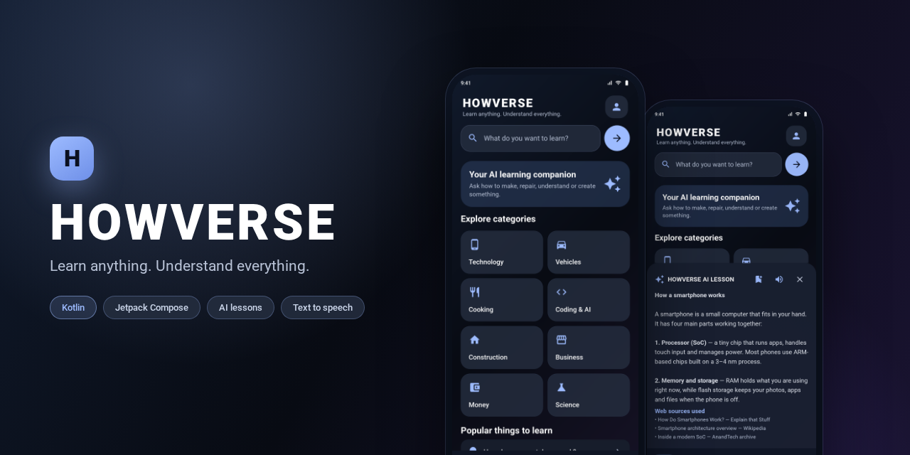
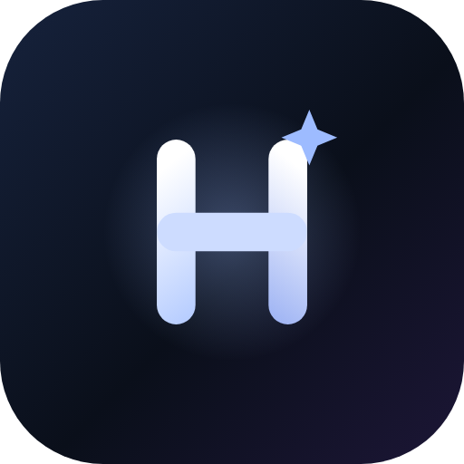
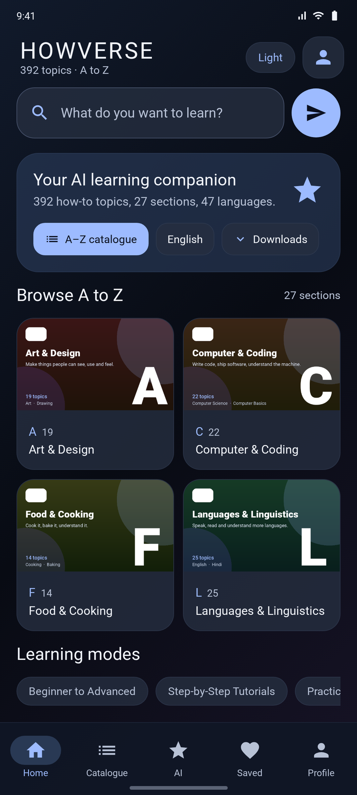
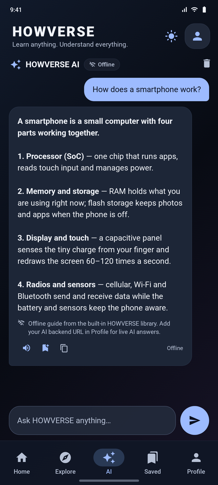
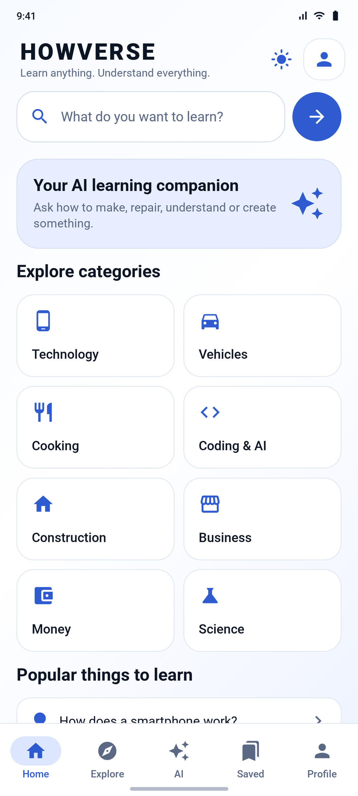
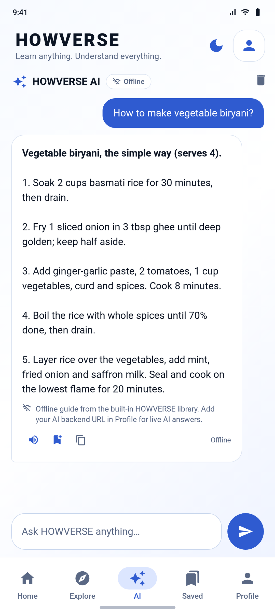
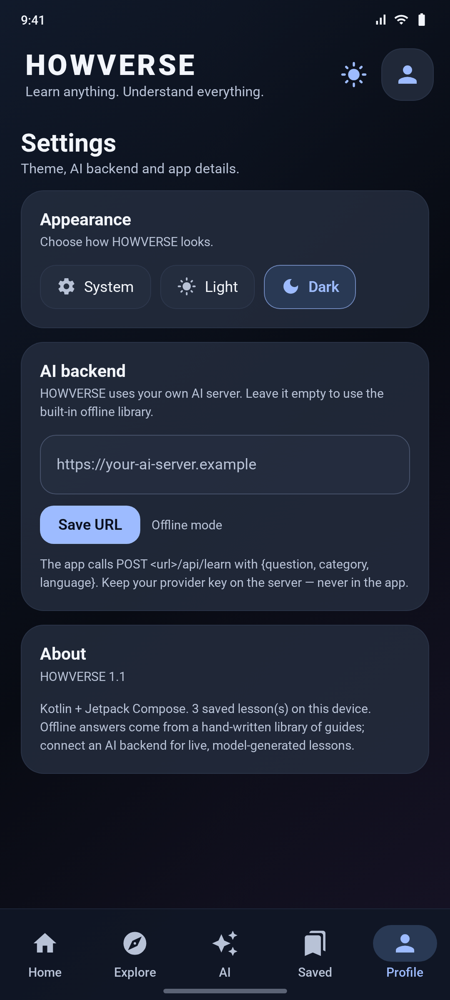
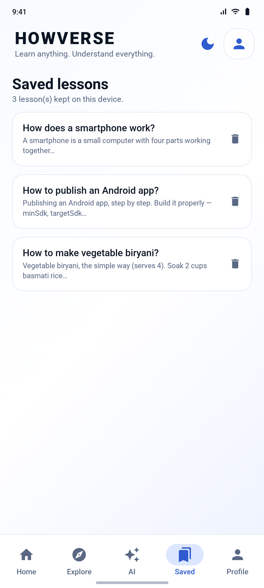
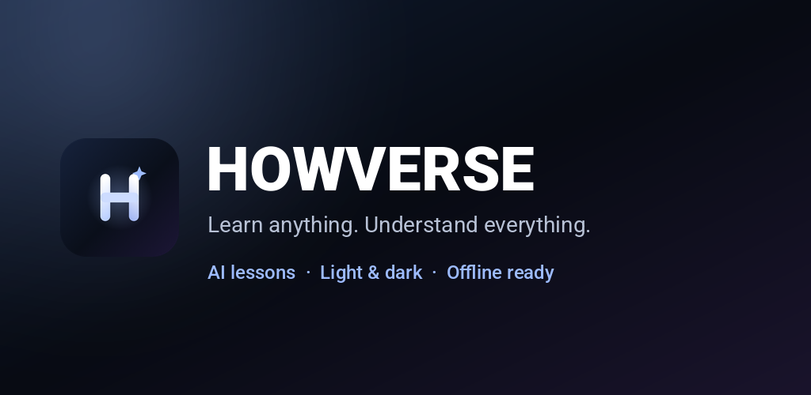
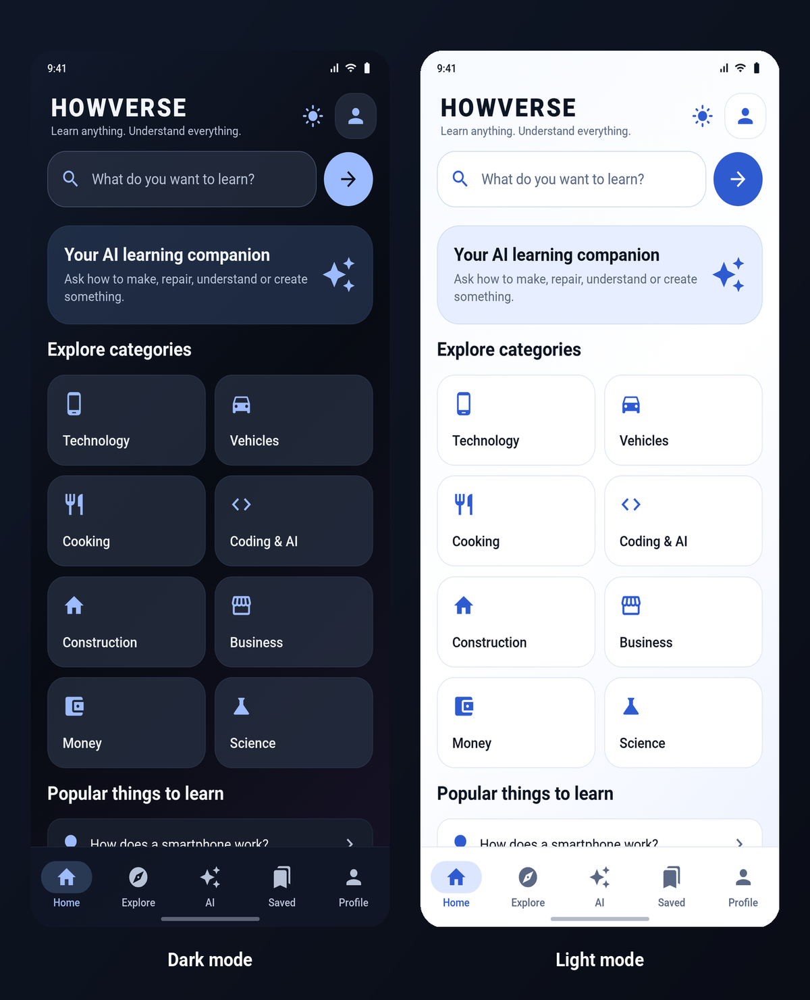

# HOWVERSE





**HOWVERSE** is a Kotlin + Jetpack Compose learning app with a glass-inspired UI, a real
in-app AI chat, light and dark themes, read-aloud and saved lessons. Ask how to make
something, repair something, understand something or build something — HOWVERSE answers
with a structured lesson.

<p>


</p>

---

## Download the APK

**[⬇ Download HOWVERSE 1.1 (debug APK)](https://github.com/technicalnihilist-lgtm/HOWVERSE/releases/latest)**

Direct file: [`HOWVERSE-1.1-debug.apk`](https://github.com/technicalnihilist-lgtm/HOWVERSE/releases/download/v1.1.0/HOWVERSE-1.1-debug.apk) · 17 MB · Android 8.0 (API 26) and above

Debug-signed, so enable "Install unknown apps" to install it. Not Play Store ready — see
[Building from source](#building-from-source) for a release build.

---

## What's new in 1.1

- **New app icon** — a proper adaptive icon (foreground, background and Android 13 themed
  monochrome layer) instead of the default Android placeholder.
- **The AI actually works out of the box.** A full AI chat screen (bubbles, typing state,
  read-aloud, save, copy) backed by two engines: your AI backend when a URL is set, and a
  built-in offline lesson library when it is not. No key, no server, no dead app.
- **Light mode** — System / Light / Dark, switchable from the header sun-moon button or
  Settings, and remembered after a restart.
- **Saved lessons persist.** They are stored on the device now instead of living in memory
  for one session.
- **Set the AI backend URL inside the app** — no rebuild needed to point HOWVERSE at your
  own server.

---

## Demo


A 12-second walkthrough: dark home, tap a category, the AI answer arrives, then the theme
switches to light. Full quality: [HOWVERSE-demo.mp4](https://github.com/technicalnihilist-lgtm/HOWVERSE/releases/download/v1.1.0/HOWVERSE-demo.mp4) — 1080 × 2400, H.264, 12 s.
The clip is built from the app's real Compose UI — no mock-ups.

---

## Screenshots

| Home (dark) | AI chat (dark) |
|:---:|:---:|
|  |  |
| Dashboard, search and ten learning categories | Ask anything — answer bubbles with sources, speak, save and copy |

| Home (light) | AI chat (light) |
|:---:|:---:|
|  |  |
| The same screens in light mode | Light mode keeps full contrast on every surface |

| Settings (dark) | Saved lessons (light) |
|:---:|:---:|
|  |  |
| Theme picker and AI backend URL | Lessons saved on the device |

Full-resolution PNGs (1080 × 2400) and the 512 × 512 icon are in [`screenshots/`](screenshots).

---

## Example images

| Play Store feature graphic (1024 × 500) | Dark and light, side by side |
|:---:|:---:|
|  |  |

Both are ready to upload: the feature graphic fits the Play Console listing requirement, and
the comparison image works as a first README or store screenshot. The 512 × 512 app icon is
at [`screenshots/icon-512.png`](screenshots/icon-512.png).

---

## How the AI works

HOWVERSE never ships a provider key. There are two engines behind one interface:

```
                      ┌───────────────────────────────┐
   your question ───► │  LessonEngine.ask()           │
                      └───────────┬───────────────────┘
                                  │
             backend URL set?     │     no / unreachable
                    ┌─────────────┴──────────────┐
                    ▼                            ▼
        ┌───────────────────────┐      ┌────────────────────────┐
        │  POST <url>/api/learn │      │  OfflineBrain          │
        │  Express backend      │      │  built-in guide library│
        │  → AI model (+search) │      │  + lesson framework    │
        └───────────────────────┘      └────────────────────────┘
```

- **Live AI** — set your backend URL in *Settings → AI backend*. The app calls
  `POST <url>/api/learn` with `{question, category, language}` and renders the answer plus
  any web sources the backend used. The chat header shows a **Live AI** chip.
- **Offline library** — with no URL, answers come from a hand-written library of guides
  (smartphones, cooking, publishing an app, AI, electrical safety, vehicles, money,
  business, plumbing, painting, coding, careers, networks, solar) plus a general-purpose
  lesson framework for anything else. The header shows **Offline** and every answer is
  labelled, so an offline guide is never passed off as a model answer.

Honest limits: the offline library is not a language model — it is curated text with keyword
matching. Live, model-generated answers need your backend running.

---

## Features

- **AI chat** — conversation bubbles, a "Thinking…" state, read-aloud, save and copy on
  every answer.
- **Ten categories** — Technology, Vehicles, Cooking, Coding & AI, Construction, Business,
  Money, Science, Home skills and Publishing, each with a one-tap starter lesson.
- **Light and dark themes** — a complete second palette, not an inverted dark theme:
  separate surfaces, borders, bubbles and accent colours, plus matching status-bar icons.
- **Adaptive app icon** — vector foreground/background plus a monochrome layer for Android
  13 themed icons.
- **Saved lessons** — persisted with SharedPreferences, delete-able, reopenable.
- **Read aloud** — Android `TextToSpeech` (en-IN).
- **Edge-to-edge Compose UI** — safe-drawing insets, keyboard-aware input, responsive grid.

---

## Project structure

```
HOWVERSE/
├── app/
│   ├── build.gradle.kts
│   └── src/main/
│       ├── AndroidManifest.xml
│       ├── java/com/howverse/app/
│       │   ├── MainActivity.kt            # edge-to-edge host
│       │   ├── data/
│       │   │   ├── Models.kt              # Lesson, ChatMessage, SavedLesson
│       │   │   ├── LessonEngine.kt        # backend call + offline fallback
│       │   │   ├── OfflineBrain.kt        # built-in guide library
│       │   │   └── Prefs.kt               # theme, backend URL, saved lessons
│       │   └── ui/
│       │       ├── HowverseApp.kt         # all screens: home, explore, chat, saved, settings
│       │       └── Theme.kt               # dark + light palettes
│       └── res/
│           ├── drawable/ic_launcher_*.xml # icon foreground / background / monochrome
│           ├── mipmap-anydpi-v26/         # adaptive icon
│           ├── values/                    # colours and theme
│           └── xml/network_security_config.xml
├── backend/                               # Express API that talks to the AI provider
├── screenshots/                           # 1080 × 2400 screenshots, banner, icon, feature graphic
│                                          # (demo video + GIF live on the Releases page)
├── gradle/wrapper/                        # Gradle wrapper 8.11.1
├── build.gradle.kts · settings.gradle.kts · gradle.properties
├── gradlew · gradlew.bat
└── README.md
```

---

## Building from source

### Requirements

- Android Studio (current stable) or JDK 17 + Android SDK 35 on the command line
- Android SDK platform 35 and build-tools 35.0.0
- Node.js 18+ for the optional backend

### 1. Build the app

```bash
./gradlew assembleDebug          # app/build/outputs/apk/debug/app-debug.apk
./gradlew assembleRelease        # needs a signing config for distribution
```

### 2. (Optional) Configure the AI backend

The app works without a backend. To get live, model-generated lessons:

```bash
cd backend
npm install
cp .env.example .env      # set OPENAI_API_KEY, optional TAVILY_API_KEY
npm start                 # http://localhost:3000/health
```

Deploy it to a host with HTTPS, then paste that URL into **Settings → AI backend** in the
app — no rebuild needed. For the Android emulator only, `http://10.0.2.2:3000` is allowed
by the bundled network security config; every other cleartext host is blocked.

Keep provider keys on the server. Never put them in Kotlin, an APK, or this repository.

---

## Tech stack

| Layer | Choice |
|---|---|
| Language | Kotlin 2.0.21 |
| UI | Jetpack Compose (BOM 2024.12.01), Material 3, material-icons-extended |
| State | Compose state + `rememberCoroutineScope`, no ViewModel needed yet |
| Storage | SharedPreferences (theme, backend URL, saved lessons) |
| Networking | OkHttp 4.12 + `org.json` |
| Speech | Android `TextToSpeech` (en-IN) |
| Backend | Node.js 18+, Express 4, express-rate-limit, dotenv |
| Build | AGP 8.7.3, Gradle 8.11.1, JDK 17, compileSdk/targetSdk 35, minSdk 26 |

---

## Roadmap

Still to do before a production release:

- Markdown rendering for lesson answers (currently plain text with line breaks)
- Room/DataStore instead of SharedPreferences for larger saved-lesson collections
- Streaming responses from the backend
- Backend authentication, abuse monitoring and stronger server-side safety review
- Crash reporting, privacy policy, and account deletion if accounts are added
- Automated UI and unit tests
- Image generation, only through a separate authenticated backend endpoint

---

## Safety and accuracy

HOWVERSE is a learning aid, not a substitute for licensed professionals. The backend prompt
deliberately limits step-by-step instructions for hazardous repairs, electrical or gas work,
structural work, security bypasses and risky device modifications. Always verify critical
instructions against official manuals and qualified professionals.

---

## Credits

App name, design and source: **HOWVERSE**. Screenshots were captured at 1080 × 2400 from the
app's Compose UI; the icon is the same adaptive icon the app ships with.
