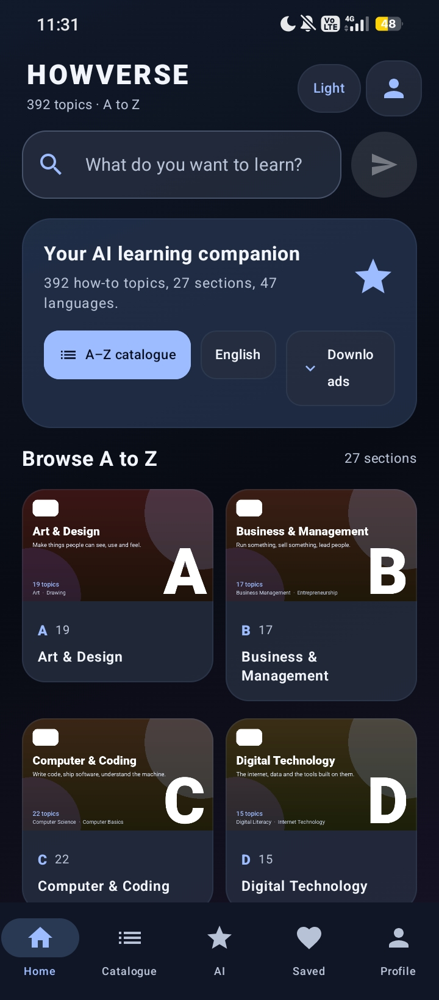
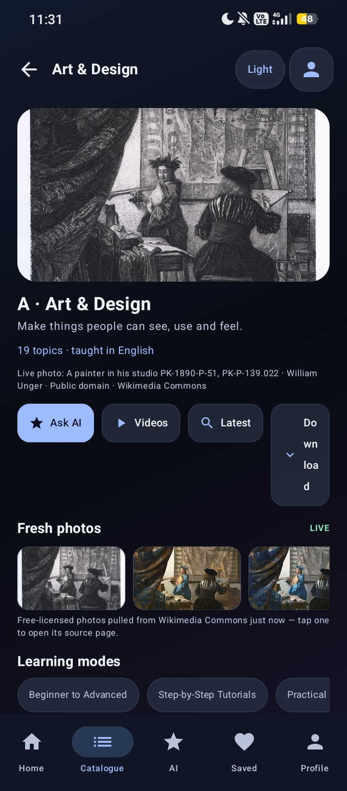
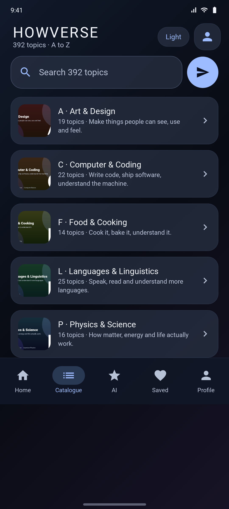
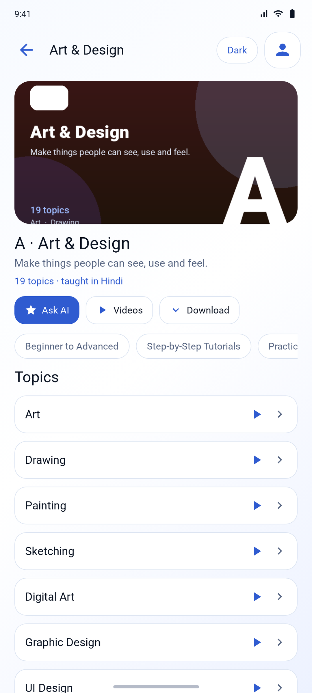
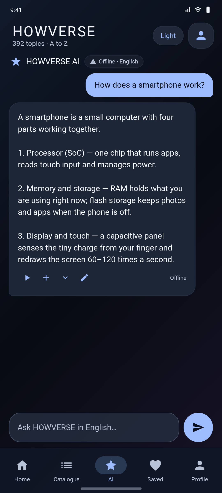
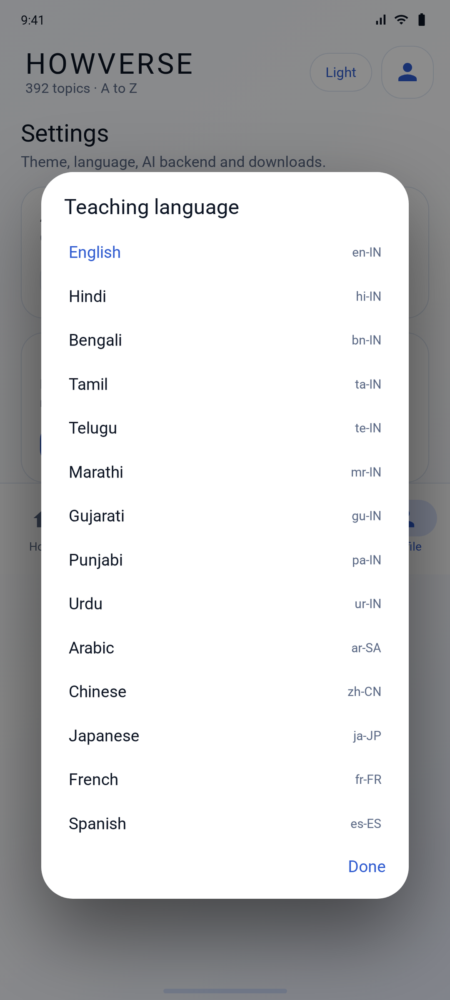
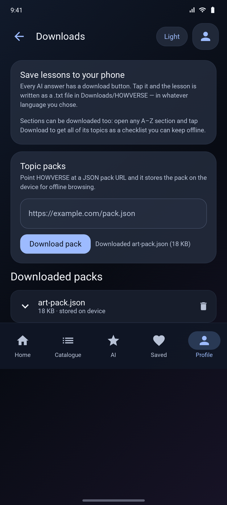

# HOWVERSE


**HOWVERSE** is a Kotlin + Jetpack Compose learning app with a **complete A-to-Z how-to
catalogue** — 392 topics across 27 sections, 12 learning modes and 47 languages — plus an AI
chat, in-app video browsing, downloadable lessons and light/dark themes.

<p>


</p>

---

## Download the APK

**[⬇ Download HOWVERSE 2.7 (debug APK)](https://github.com/technicalnihilist-lgtm/HOWVERSE/releases/latest)**

Direct file: [`HOWVERSE-2.7-debug.apk`](https://github.com/technicalnihilist-lgtm/HOWVERSE/releases/download/v2.7.0/HOWVERSE-2.7-debug.apk) · 11 MB · Android 8.0 (API 26) and above

Debug-signed — enable "Install unknown apps" to install. It updates over 1.0/1.1 (same
package, same key). Not Play Store ready; see [Building from source](#building-from-source).

---

## What's new in 2.7

- **Real photos, live from Wikimedia Commons** - the home A-Z grid and every section page show a
  current free-licensed photo of that topic, fetched at runtime (CC0 / public domain / CC BY /
  CC BY-SA only). Tiles load lazily and fall back to the bundled artwork offline.
- **Photos open inside the app** - tapping any photo opens an in-app viewer with its title,
  author and licence. No browser, no Wikipedia tab; only the licence link leaves the app, as
  CC BY requires.
- **Voices that sound like a person** - the app picks the best voice the device has for your
  language, prefers Google network voices, and prompts to install voice data instead of going
  silent.
- **Lessons that teach** - offline answers are section-aware (cooking reads like cooking, coding
  like coding) and follow ten concrete steps: what it is, prerequisites, five words, the first
  30 minutes, a worked example, common mistakes, self-check, mistake list, teach-back, spaced
  review.
- **Latest videos, honestly sorted** - a Desktop / Mobile switch in the video screen; only the
  desktop view honours YouTube upload-date filter, so Latest really is newest-first.

## What's new in 2.0

- **Complete A–Z catalogue** — every section from the master list is in the app: A Art &
  Design … Z Zero to Advanced Practical Learning, plus a ★ section of 37 additional global
  areas. **392 topics, 27 sections, 12 learning modes.**
- **Section artwork** — 27 illustrated section headers ship inside the APK (generated vector-style
  art, one per section) shown on the home grid, the catalogue list and every section page.
- **In-app video browsing** — every topic has a play button that opens an in-app YouTube
  search for that exact topic (`VideoActivity`, a WebView). Videos play in the YouTube
  player; nothing is bundled or scraped.
- **47 languages** — pick a teaching language; it is sent to the AI backend with every
  question and used for the read-aloud voice (`TextToSpeech` locale). See
  [Languages](#languages--voices) for what is and isn't translated.
- **Downloads** — every AI answer has a download button that writes the lesson as a `.txt`
  into `Downloads/HOWVERSE`, in the language you chose. Sections can be downloaded as a
  topic checklist, and the Downloads screen can fetch **topic packs** (JSON) from a URL you
  configure and keep them on the device.
- **Smaller and faster** — the 20 MB icon library was replaced with the core Material icon
  set: the APK went from 17 MB to **11 MB** and builds in minutes instead of tens of minutes.
- Light/dark themes, saved lessons, read-aloud and the AI chat from 1.1 are all still here.

---

## Screenshots

| Home - live photos (2.7) | Section - live photo and credit (2.7) |
|:---:|:---:|
|  |  |
| Real Wikimedia Commons photos, loaded lazily, LIVE badge per tile | Photo credit under the hero, in-app viewer on tap |


| Home — A–Z grid (dark) | Catalogue (dark) |
|:---:|:---:|
|  |  |
| 392 topics, 27 sections, language and downloads in one tap | Every section with its artwork, topic count and blurb |

| Section page (light) | AI chat (dark) |
|:---:|:---:|
|  |  |
| Artwork, learning modes, topic list with ask + video buttons | Answer bubbles with speak, save, download and copy |

| 47 languages (light) | Downloads (dark) |
|:---:|:---:|
|  |  |
| Teaching language picker with locale tags | Lesson saving and topic pack downloads |

Full-resolution PNGs (1080 × 2400), the 512 × 512 icon, a Play Store feature graphic and a
dark-vs-light comparison are in [`screenshots/`](screenshots).

---

## The catalogue

| | Section | Topics | | Section | Topics |
|---|---|---|---|---|---|
| **A** | Art & Design | 19 | **N** | Nature & Environment | 13 |
| **B** | Business & Management | 17 | **O** | Office & Productivity | 11 |
| **C** | Computer & Coding | 22 | **P** | Physics & Science | 16 |
| **D** | Digital Technology | 15 | **Q** | Quality & Professional Skills | 9 |
| **E** | Engineering | 14 | **R** | Robotics & Research | 12 |
| **F** | Food & Cooking | 14 | **S** | Skills & Self Development | 12 |
| **G** | Geography & Geology | 13 | **T** | Transport & Technology | 11 |
| **H** | History & Heritage | 11 | **U** | Utilities & Everyday Life | 12 |
| **I** | Internet & Media | 12 | **V** | Visual & Performing Arts | 15 |
| **J** | Journalism & Communication | 12 | **W** | World Cultures & Society | 11 |
| **K** | Knowledge & Research | 10 | **X** | Exploration & Advanced Science | 10 |
| **L** | Languages & Linguistics | 25 | **Y** | Yoga, Wellness & Sports | 15 |
| **M** | Mathematics | 13 | **Z** | Zero to Advanced Practical Learning | 11 |
| | | | **★** | Additional Global Learning Areas | 37 |

**Learning modes** (every section can be taught in each): Beginner to Advanced, Step-by-Step
Tutorials, Practical Projects, Interactive Lessons, Examples and Demonstrations, Exercises
and Quizzes, Troubleshooting, Real-World Applications, Learning Roadmaps, Skill Assessment,
Personalized Learning, Multilingual Teaching.

The whole catalogue lives in
[`data/Catalogue.kt`](app/src/main/java/com/howverse/app/data/Catalogue.kt) — add a topic by
adding one string.

---

## Images and videos — what is actually in the app

Being precise, because this matters:

- **Images** — the app ships **27 illustrated section headers** (`app/src/main/assets/art/`),
  one per section, generated in-house. They are category artwork, not photographs, and there
  is no per-topic photo library. A per-topic image would need a licensed photo/CDN per topic
  (~392 assets) — that is a content deal, not code.
- **Videos** — the app does **not** bundle video files (that would be hundreds of MB). Every
  topic's play button opens an **in-app YouTube search** for that topic in `VideoActivity`.
  Results and playback come from YouTube, so nothing is redistributed.
- Everything else (catalogue text, lesson text, downloads) is real and offline-capable.

---

## Languages & voices

47 languages are selectable: English, Hindi, Bengali, Tamil, Telugu, Marathi, Gujarati,
Punjabi, Urdu, Kannada, Malayalam, Odia, Assamese, Sanskrit, Nepali, Sinhala, Arabic,
Persian, Turkish, Hebrew, Russian, Ukrainian, Greek, German, French, Spanish, Portuguese,
Italian, Dutch, Polish, Swedish, Danish, Finnish, Czech, Romanian, Hungarian, Indonesian,
Malay, Vietnamese, Thai, Filipino, Swahili, Afrikaans, Chinese, Japanese, Korean and
Hinglish.

What the choice does:

1. **Lesson language** — sent as `language` with every `/api/learn` request, together with an
   instruction to answer in that language. Your AI backend does the translating; a model that
   knows the language answers in it.
2. **Read-aloud voice** — `TextToSpeech.setLanguage(tag)`. If the device has no voice
   installed for that locale the app says so in Settings and in the chat.
3. **Downloads** — the saved `.txt` records which language the lesson was produced in.

What it does **not** do: translate the app's own interface strings. The UI stays in English,
and the built-in offline library is English-only — both are stated inside the app rather than
hidden.

---

## How the AI works

```
                      ┌───────────────────────────────┐
   your question ───► │  LessonEngine.ask(            │
   + language         │    question, category,        │
                      │    backendUrl, language )     │
                      └───────────┬───────────────────┘
                                  │
             backend URL set?     │     no / unreachable
                    ┌─────────────┴──────────────┐
                    ▼                            ▼
        ┌───────────────────────┐      ┌────────────────────────┐
        │  POST <url>/api/learn │      │  OfflineBrain          │
        │  Express backend      │      │  built-in guide library│
        │  → AI model (+search) │      │  + lesson framework    │
        └───────────────────────┘      └────────────────────────┘
```

Set your backend URL in **Settings → AI backend** — no rebuild. The chat header shows a
**Live AI** chip when a backend is configured and **Offline** when answers come from the
built-in library. Offline answers are always labelled; nothing is passed off as model output.

Honest limits: the offline library is curated text with keyword matching, not a language
model, and it is English only.

---

## Downloads

| What | Where it goes | How |
|---|---|---|
| A single lesson | `Downloads/HOWVERSE/<question>.txt` | Download icon on any AI answer |
| A whole section | `Downloads/HOWVERSE/<section>-topics.txt` | Download button on the section page |
| Topic packs (JSON) | App-private storage, listed in Downloads | Paste a pack URL on the Downloads screen |

Lesson files use the MediaStore Downloads API on Android 10+, so no storage permission is
needed; on Android 8–9 they are written to the app's external downloads folder.

---

## Features

- Complete A–Z catalogue with search across all 392 topics
- Section artwork, learning modes, per-topic ask and video actions
- AI chat with read-aloud, save, download and copy on every answer
- 47-language teaching + voice selection
- Light and dark themes (a full second palette, not an inversion)
- Saved lessons and downloaded files persist on the device
- Adaptive app icon with an Android 13 themed monochrome layer
- Edge-to-edge Compose UI, keyboard-aware input, responsive layout

---

## Project structure

```
HOWVERSE/
├── app/src/main/
│   ├── AndroidManifest.xml
│   ├── assets/art/                        # 27 section illustrations (a.png … star.png)
│   ├── java/com/howverse/app/
│   │   ├── MainActivity.kt                # edge-to-edge host
│   │   ├── VideoActivity.kt               # in-app YouTube search per topic
│   │   ├── data/
│   │   │   ├── Catalogue.kt               # 392 topics, 27 sections, 12 learning modes
│   │   │   ├── Languages.kt               # 47 languages with BCP-47 tags
│   │   │   ├── LessonEngine.kt            # backend call + offline fallback
│   │   │   ├── OfflineBrain.kt            # built-in guide library
│   │   │   ├── Downloader.kt              # lesson/section/pack downloads
│   │   │   ├── Models.kt
│   │   │   └── Prefs.kt                   # theme, language, URLs, saved lessons
│   │   └── ui/
│   │       ├── HowverseApp.kt             # all screens
│   │       └── Theme.kt                   # dark + light palettes
│   └── res/                               # icons, theme, network security config
├── backend/                               # Express API that talks to the AI provider
├── screenshots/                           # 1080 × 2400 screenshots, banner, icon, feature graphic
├── gradle/wrapper/                        # Gradle wrapper 8.11.1
├── build.gradle.kts · settings.gradle.kts · gradle.properties
├── gradlew · gradlew.bat
└── README.md
```

---

## Building from source

```bash
cd backend && npm install && cp .env.example .env   # optional: only for live AI
./gradlew assembleDebug                            # app/build/outputs/apk/debug/app-debug.apk
```

Requirements: JDK 17, Android SDK 35 (platform + build-tools 35.0.0), Node 18+ for the
backend.

The bundled network security config allows cleartext HTTP only for `10.0.2.2`, `localhost`
and `127.0.0.1` (emulator development). Everything else must be HTTPS. Keep provider keys on
the server, never in the app or this repo.

---

## Tech stack

| Layer | Choice |
|---|---|
| Language | Kotlin 2.0.21 |
| UI | Jetpack Compose (BOM 2024.12.01), Material 3, core Material icons |
| State | Compose state + coroutines, no ViewModel needed yet |
| Storage | SharedPreferences + MediaStore Downloads + app-private packs |
| Networking | OkHttp 4.12 + `org.json` |
| Speech | Android `TextToSpeech` (per-language locale) |
| Video | `WebView` → YouTube search per topic |
| Backend | Node.js 18+, Express 4, express-rate-limit, dotenv |
| Build | AGP 8.7.3, Gradle 8.11.1, JDK 17, compileSdk/targetSdk 35, minSdk 26 |

---

## Roadmap

- Per-topic images (needs a licensed photo source or an image-generation endpoint)
- Markdown rendering for lesson answers
- In-app video playback with a real video API instead of a YouTube search
- Room/DataStore for larger saved-lesson collections
- Streaming AI responses, backend authentication, crash reporting
- Automated UI and unit tests, Play Store release signing and privacy policy

---

## Safety and accuracy

HOWVERSE is a learning aid, not a substitute for licensed professionals. The AI request asks
the backend to refuse instructions that enable violence, illegal activity, dangerous
experiments, cyber abuse or other harm, and the app limits step-by-step instructions for
hazardous repairs, electrical/gas work, structural work, security bypasses and risky device
modifications. Always verify critical instructions against official manuals and qualified
professionals.

---

## Credits

App name, design and source: **HOWVERSE**. Screenshots were captured at 1080 × 2400 from the
app's Compose UI; the section artwork and the adaptive icon ship inside the APK.

---

## ⭐ Like this work? Give it a star

If you like this app and our work, please **star this repository** ⭐ and **[follow technicalnihilist-lgtm on GitHub](https://github.com/technicalnihilist-lgtm)**. If our work isn't for you, that's completely fine — the choice is yours. Thank you for stopping by!

<details>
<summary><b>🌍 Same message in 32 languages (A–Z + Indian languages)</b></summary>

- **A — Arabic** (العربية): ⭐ إذا أعجبك هذا التطبيق وعملنا، فيرجى منح المستودع نجمة ومتابعتنا. وإذا لم يعجبك عملنا، فلا مشكلة على الإطلاق — القرار قرارك. شكرًا لزيارتك!
- **B — Bengali** (বাংলা): ⭐ যদি আপনার এই অ্যাপ এবং আমাদের কাজ ভালো লাগে, তবে অনুগ্রহ করে রিপোজিটরিটিকে একটি স্টার দিন এবং আমাদের ফলো করুন। আমাদের কাজ যদি আপনার পছন্দ না হয়, তাতেও কোনো সমস্যা নেই — সিদ্ধান্ত আপনার। আমাদের পেজে আসার জন্য ধন্যবাদ!
- **C — Chinese** (中文): ⭐ 如果你喜欢这个应用和我们的作品，请给仓库点个星标并关注我们。如果我们的作品不适合你，也完全没关系——选择权在你。感谢你的到访！
- **D — Dutch** (Nederlands): ⭐ Vind je deze app en ons werk leuk? Geef de repository dan een ster en volg ons. Vind je ons werk niets, dan is dat helemaal prima — de keuze is aan jou. Bedankt voor je bezoek!
- **E — English** (English): ⭐ If you like this app and our work, please give the repository a star and follow us. If our work isn't for you, that's completely fine — the choice is yours. Thank you for stopping by!
- **F — French** (Français): ⭐ Si cette application et notre travail vous plaisent, mettez une étoile au dépôt et suivez-nous. Si notre travail n'est pas pour vous, aucun souci — c'est votre choix. Merci de votre visite !
- **G — German** (Deutsch): ⭐ Wenn dir diese App und unsere Arbeit gefallen, gib dem Repository einen Stern und folge uns. Wenn unsere Arbeit nichts für dich ist, ist das völlig in Ordnung — die Wahl liegt bei dir. Danke fürs Vorbeischauen!
- **H — Hindi** (हिन्दी): ⭐ अगर आपको यह ऐप और हमारा काम पसंद है, तो कृपया रिपॉजिटरी को स्टार दें और हमें फॉलो करें। अगर हमारा काम आपके लिए नहीं है, तो भी कोई बात नहीं — यह पूरी तरह आपकी मर्ज़ी है। यहाँ आने के लिए आपका धन्यवाद!
- **I — Indonesian** (Bahasa Indonesia): ⭐ Jika kamu suka aplikasi ini dan karya kami, beri bintang pada repositori ini dan ikuti kami. Kalau karya kami bukan untukmu, tidak masalah sama sekali — itu pilihanmu. Terima kasih sudah mampir!
- **J — Japanese** (日本語): ⭐ このアプリと私たちの仕事が気に入ったら、リポジトリにスターを付けてフォローしてください。合わない場合はまったく問題ありません — 選ぶのはあなたです。お越しいただきありがとうございます！
- **K — Korean** (한국어): ⭐ 이 앱과 저희 작업이 마음에 드신다면 저장소에 스타를 눌러 주시고 팔로우해 주세요. 저희 작업이 맞지 않으셔도 전혀 괜찮습니다 — 선택은 여러분의 몫입니다. 방문해 주셔서 감사합니다!
- **L — Lithuanian** (Lietuvių): ⭐ Jei tau patinka ši programa ir mūsų darbas, duok saugyklai žvaigždutę ir sek mus. Jei mūsų darbas ne tau, viskas gerai — pasirinkimas tavo. Ačiū, kad užsukai!
- **M — Malayalam** (മലയാളം): ⭐ നിങ്ങൾക്ക് ഈ ആപ്പും ഞങ്ങളുടെ പ്രവർത്തനവും ഇഷ്ടപ്പെട്ടെങ്കിൽ, ദയവായി റെപ്പോസിറ്ററിക്ക് ഒരു സ്റ്റാർ നൽകുകയും ഞങ്ങളെ ഫോളോ ചെയ്യുകയും ചെയ്യുക. ഞങ്ങളുടെ പ്രവർത്തനം നിങ്ങൾക്ക് അനുയോജ്യമല്ലെങ്കിൽ, അതും തികച്ചും കുഴപ്പമില്ല — തീരുമാനം നിങ്ങളുടേതാണ്. ഇവിടെ വന്നതിന് നന്ദി!
- **N — Nepali** (नेपाली): ⭐ यदि तपाईंलाई यो एप र हाम्रो काम मन पर्‍यो भने, कृपया रिपोजिटरीलाई स्टार दिनुहोस् र हामीलाई फलो गर्नुहोस्। यदि हाम्रो काम तपाईंलाई मन पर्दैन भने, पनि ठीकै छ — यो तपाईंको इच्छा हो। यहाँ आउनुभएकोमा धन्यवाद!
- **O — Odia** (ଓଡ଼ିଆ): ⭐ ଯଦି ଆପଣଙ୍କୁ ଏହି ଆପ୍ ଏବଂ ଆମର କାମ ଭଲ ଲାଗୁଛି, ତେବେ ଦୟାକରି ରିପୋଜିଟୋରୀକୁ ଗୋଟିଏ ଷ୍ଟାର୍ ଦିଅନ୍ତୁ ଏବଂ ଆମକୁ ଫଲୋ କରନ୍ତୁ। ଯଦି ଆମର କାମ ଆପଣଙ୍କ ପାଇଁ ନୁହେଁ, ତେବେ କିଛି ଅସୁବିଧା ନାହିଁ — ପସନ୍ଦ ଆପଣଙ୍କର। ଆମ ପାଖକୁ ଆସିଥିବାରୁ ଧନ୍ୟବାଦ!
- **P — Polish** (Polski): ⭐ Jeśli podoba Ci się ta aplikacja i nasza praca, daj repozytorium gwiazdkę i obserwuj nas. Jeśli nasza praca nie jest dla Ciebie, to zupełnie w porządku — wybór należy do Ciebie. Dziękujemy za odwiedziny!
- **Q — Quechua** (Runa Simi): ⭐ Kay app, ñuqaykup ruwasqanchikpas gustasunki chayqa, repositorioman huk estrella churay, ñuqaykutapas qatipayku. Mana gustasunki chayqa, allinmi — qampa akllayki. Hamusqaykimanta sulpayki!
- **R — Russian** (Русский): ⭐ Если вам нравится это приложение и наша работа, поставьте звёздочку репозиторию и подпишитесь на нас. Если наша работа не для вас — это совершенно нормально, выбор за вами. Спасибо, что заглянули!
- **S — Spanish** (Español): ⭐ Si te gusta esta app y nuestro trabajo, dale una estrella al repositorio y síguenos. Si nuestro trabajo no es para ti, no pasa nada — la decisión es tuya. ¡Gracias por pasarte!
- **T — Tamil** (தமிழ்): ⭐ உங்களுக்கு இந்த ஆப்பும் எங்க வேலையும் பிடிச்சிருந்தா, தயவுசெஞ்சு இந்த ரெபாசிட்டரிக்கு ஒரு ஸ்டார் குடுத்து, எங்களை ஃபாலோ பண்ணுங்க. எங்க வேலை உங்களுக்கு செட் ஆகலைன்னாலும் பரவாயில்லை — அது உங்க விருப்பம். இங்கே வந்ததுக்கு நன்றி!
- **U — Urdu** (اردو): ⭐ اگر آپ کو یہ ایپ اور ہمارا کام پسند آئے تو براہ کرم ریپازٹری کو سٹار دیں اور ہمیں فالو کریں۔ اگر ہمارا کام آپ کے لیے نہیں ہے، تو یہ بالکل ٹھیک ہے — انتخاب آپ کا ہے۔ یہاں تشریف لانے کا شکریہ!
- **V — Vietnamese** (Tiếng Việt): ⭐ Nếu bạn thích ứng dụng này và công việc của chúng tôi, hãy tặng kho lưu trữ một ngôi sao và theo dõi chúng tôi. Nếu công việc của chúng tôi không phù hợp với bạn, điều đó hoàn toàn ổn — lựa chọn là của bạn. Cảm ơn bạn đã ghé qua!
- **W — Welsh** (Cymraeg): ⭐ Os ydych chi'n hoffi'r ap hwn a'n gwaith, rhowch seren i'r storfa a dilynwch ni. Os nad yw ein gwaith ar eich cyfer, mae hynny'n hollol iawn — chi sydd i benderfynu. Diolch am alw heibio!
- **X — Xhosa** (isiXhosa): ⭐ Ukuba uyayithanda le app nomsebenzi wethu, nika irepo inkwenkwezi kwaye usilandele. Ukuba umsebenzi wethu awukufanelanga, akukho ngxaki — lukhetho lwakho. Enkosi ngokutyelela!
- **Y — Yoruba** (Yorùbá): ⭐ Bí app yìí àti iṣẹ́ wa bá wù ọ́, jọ̀wọ́ fún àkójọpọ̀ náà ní ìràwọ̀ kí o sì tẹ̀lé wa. Bí iṣẹ́ wa kò bá yẹ ọ́, kò séwu — ìwọ ni ó yàn. Ẹ ṣé fún wíwá!
- **Z — Zulu** (isiZulu): ⭐ Uma uthanda le app nomsebenzi wethu, nikeza isitoreji inkanyezi bese usilandela. Uma umsebenzi wethu ungakufanele, akunankinga — wukukhetha kwakho. Siyabonga ngokuvakasha!

**More Indian languages**

- **Assamese** (অসমীয়া): ⭐ যদি আপুনি এই এপটো আৰু আমাৰ কাম ভাল পায়, তেন্তে অনুগ্ৰহ কৰি ৰিপজিটৰীটোক এটা ষ্টাৰ দিয়ক আৰু আমাক ফ'ল' কৰক। যদি আমাৰ কাম আপোনাৰ বাবে নহয়, তেন্তে সেয়া একেবাৰে ঠিক আছে — সিদ্ধান্তটো আপোনাৰ। আমাৰ ইয়ালৈ অহাৰ বাবে ধন্যবাদ!
- **Gujarati** (ગુજરાતી): ⭐ જો તમને આ એપ અને અમારું કામ ગમતું હોય, તો પ્લીઝ રિપોઝિટરીને સ્ટાર આપો અને અમને ફોલો કરો. જો અમારું કામ તમને ન ગમતું હોય, તો તે પણ બરાબર છે — પસંદગી તમારી છે. અહીં આવવા બદલ આભાર!
- **Kannada** (ಕನ್ನಡ): ⭐ ನಿಮಗೆ ಈ ಆ್ಯಪ್ ಮತ್ತು ನಮ್ಮ ಕೆಲಸ ಇಷ್ಟವಾದರೆ, ದಯವಿಟ್ಟು ರೆಪೊಸಿಟರಿಗೆ ಸ್ಟಾರ್ ಕೊಡಿ ಮತ್ತು ನಮ್ಮನ್ನು ಫಾಲೋ ಮಾಡಿ. ನಮ್ಮ ಕೆಲಸ ನಿಮಗೆ ಸರಿಹೊಂದದಿದ್ದರೆ, ಅದೂ ಪರವಾಗಿಲ್ಲ — ಆಯ್ಕೆ ನಿಮ್ಮದು. ಭೇಟಿ ನೀಡಿದ್ದಕ್ಕೆ ಧನ್ಯವಾದಗಳು!
- **Marathi** (मराठी): ⭐ जर तुम्हाला हे ॲप आणि आमचं काम आवडलं असेल, तर कृपया रिपॉझिटरीला स्टार द्या आणि आम्हाला फॉलो करा. जर आमचं काम तुम्हाला आवडत नसेल, तर काही हरकत नाही — ती तुमची निवड आहे. इथे आल्याबद्दल धन्यवाद!
- **Punjabi** (ਪੰਜਾਬੀ): ⭐ ਜੇ ਤੁਹਾਨੂੰ ਇਹ ਐਪ ਅਤੇ ਸਾਡਾ ਕੰਮ ਪਸੰਦ ਹੈ, ਤਾਂ ਕਿਰਪਾ ਕਰਕੇ ਰਿਪੋਜ਼ਟਰੀ ਨੂੰ ਸਟਾਰ ਦਿਓ ਅਤੇ ਸਾਨੂੰ ਫਾਲੋ ਕਰੋ। ਜੇ ਸਾਡਾ ਕੰਮ ਤੁਹਾਡੇ ਲਈ ਨਹੀਂ ਹੈ, ਤਾਂ ਕੋਈ ਗੱਲ ਨਹੀਂ — ਚੋਣ ਤੁਹਾਡੀ ਹੈ। ਸਾਡੇ ਪੇਜ 'ਤੇ ਆਉਣ ਲਈ ਧੰਨਵਾਦ!
- **Telugu** (తెలుగు): ⭐ మీకు ఈ యాప్, మా పని నచ్చితే, దయచేసి రిపోజిటరీకి ఒక స్టార్ ఇచ్చి మమ్మల్ని ఫాలో అవ్వండి. ఒకవేళ మా పని మీకు నచ్చకపోతే, పర్వాలేదు — అది మీ ఇష్టం. మమ్మల్ని సందర్శించినందుకు ధన్యవాదాలు!

</details>
